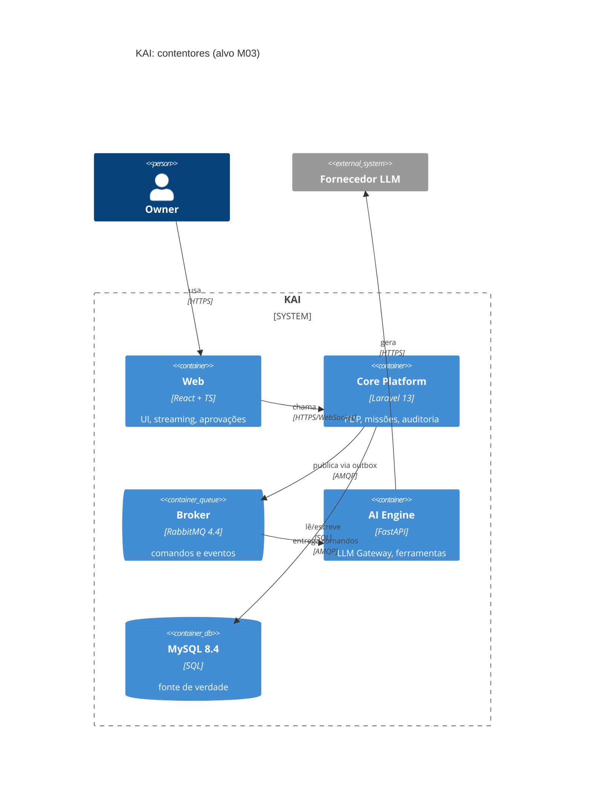

# kai-c4: diagramas C4 e de sequência (Mermaid)

## Onde guardar
| Diagrama | Ficheiro |
|---|---|
| C4 nível 1: contexto do sistema | `docs/architecture/c4-01-context.md` |
| C4 nível 2: contentores | `docs/architecture/c4-02-containers.md` |
| C4 nível 3: componentes (um por contentor) | `docs/architecture/c4-03-<contentor>.md` |
| Sequência | `docs/architecture/seq-<fluxo>.md` |
| Estados | `docs/architecture/state-<entidade>.md` |

Cria `docs/architecture/` só quando for escrever o primeiro diagrama.

## Fontes de verdade
- Contentores e responsabilidades: `docs/product/analysis.md` §5 e os ADR-0001, 0002 e 0003.
- Não desenhes componentes ou serviços que não existam nos ADRs ou no código. Se o diagrama mostrar o alvo e não o estado actual, diz-o no título ("alvo M03").

## Regras de nomes
- Pessoas e sistemas externos: nome de domínio (`Owner`, `Fornecedor LLM (Anthropic)`, `GitHub`).
- Contentores: `<Nome> [<tecnologia>]`, por exemplo `Core Platform [Laravel 13]`, `AI Engine [FastAPI/Python 3.14]`, `Broker [RabbitMQ 4.4]`.
- Relações: verbo + protocolo, por exemplo `publica comando (AMQP)`, `pede autorização (HTTPS, JWS)`.
- Identificadores Mermaid em ASCII e camelCase; texto visível em PT-PT.

## Sintaxe
- C4: blocos Mermaid `C4Context`, `C4Container` e `C4Component`, com `Person`, `System`, `System_Ext`, `Container`, `ContainerDb`, `ContainerQueue`, `Rel`, `Boundary`.
- Sequência: `sequenceDiagram`, com `autonumber` e `participant` com alias. Mostra a propagação do `traceparent` quando for relevante.
- Estados: `stateDiagram-v2`, com os estados canónicos (ex.: `AWAITING_APPROVAL`).
- Se o renderizador do destino não suportar `C4*`, usa `flowchart` com `subgraph` e indica-o.

## Procedimento
1. Lê os ADRs e as secções da análise relevantes.
2. Escreve o ficheiro com um título, uma legenda curta (âmbito, data, estado actual/alvo) e o bloco Mermaid.
3. Por baixo do diagrama, lista as decisões que o diagrama assume, com links para os ADRs.
4. Verifica que todos os elementos têm correspondência num ADR, na análise ou no código; marca o que for hipótese com [H].
5. Liga o diagrama a partir da spec ou do ADR que o motivou.

## Exemplo mínimo (nível 2)

