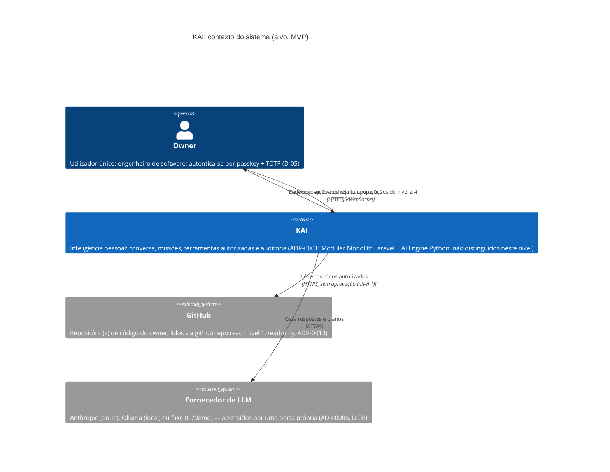

# C4 nível 1 — contexto do sistema KAI

- **Âmbito:** o MVP (fatia vertical fina, `docs/specs/001-mvp-fatia-vertical.md`), estado **alvo** (nada implementado ainda, M02 em diante).
- **Data:** 2026-11-20
- **Fontes:** `docs/product/analysis.md` §2, §5.1; ADR-0001, ADR-0002, ADR-0006, ADR-0013; D-05, D-08.

## Decisões assumidas

- **Um só sistema "KAI" neste nível:** o Core Platform (Laravel) e o AI Engine (Python) são dois deployables, mas ao utilizador e aos sistemas externos aparecem como um único sistema (ADR-0001). A fronteira interna entre eles só aparece no nível 2.
- **Owner único:** o MVP é pessoal; a evolução multi-utilizador está prevista mas fora deste diagrama (`analysis.md` A-14).
- **GitHub como único sistema externo de dados:** é a única integração do MVP (`github.repo.read`, nível 1, sem aprovação — ADR-0013). Outras integrações do PDF (email, calendário, Docker, bases de dados) estão fora do MVP (P-008 e `analysis.md` §6) e não aparecem aqui para não desenhar o que ainda não existe.
- **Fornecedor de LLM abstraído:** Anthropic, Ollama e o fornecedor `fake` da CI são a mesma relação lógica, atrás de uma porta própria (ADR-0006); não há três relações distintas neste nível.
- **A aprovação é visível no contexto:** mesmo sem mostrar missões ou níveis em detalhe, a relação "pede aprovação" regista que o LLM nunca decide isto por si (ADR-0013) — é uma interacção owner↔sistema, não um detalhe interno.

## Ligado de

- `docs/milestones/M01-product-discovery.md`, Épico E4, T4.1.
