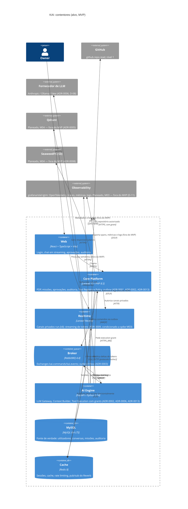

# C4 nível 2 — contentores do KAI

- **Âmbito:** o MVP (fatia vertical fina), estado **alvo** (nada implementado ainda, M02 em diante). Qdrant e SeaweedFS aparecem marcados "planeado, M04" — fazem parte da arquitectura alvo, mas não do MVP.
- **Data:** 2026-11-20
- **Fontes:** `docs/product/analysis.md` §5.1, §5.5; ADR-0001, ADR-0002, ADR-0003, ADR-0006, ADR-0008, ADR-0009, ADR-0010, ADR-0013.

## Decisões assumidas

- **Dois deployables, uma fronteira de segurança (ADR-0001, ADR-0002):** o Core Platform é o único escritor de missões, aprovações e auditoria; o AI Engine não tem estado de negócio autoritativo.
- **`execution grant` síncrono (ADR-0002 §5.5, ADR-0010):** o AI Engine pede autorização ao Core Platform por HTTPS/JWS antes de executar qualquer ferramenta — é a única chamada síncrona interna além dos *health checks*.
- **Streaming fora do RabbitMQ (ADR-0009):** os deltas de tokens vão por um canal privado do Reverb, autorizado pelo Laravel; a mensagem final é que viaja pelo broker (`ai.conversation.turn.completed.v1`). Esta decisão depende de um spike no M03; se falhar, o Reverb deixa de receber publicação directa do AI Engine e passa a SSE através do Core Platform.
- **Redis sem filas entre serviços (`analysis.md` A-11):** serve cache, sessões, rate limiting e o pub/sub do Reverb; nunca mensageria entre Core Platform e AI Engine.
- **Qdrant e SeaweedFS "planeado, M04":** aparecem no diagrama porque já têm ADR aceite (0005, 0008) e fazem parte da arquitectura alvo, mas nenhuma relação com eles existe antes do M04 — não têm *grant* nem fluxo de dados no MVP.
- **Observability "planeado, M03" (D-11):** o PDF (p.7) mostra-a como uma coluna à parte, ligada por linha tracejada à fronteira Core Platform/AI Intelligence, não como mais uma camada na vertical principal — reflecte-se aqui como um sistema externo a que os dois contentores exportam, não como mais um contentor da fronteira `kai`.
- **GitHub é a única integração externa de dados do MVP:** `github.repo.read`, nível 1, sem aprovação (ADR-0013); passa sempre por um *grant*, nunca é uma chamada livre do AI Engine.

## Ligado de

- `docs/milestones/M01-product-discovery.md`, Épico E4, T4.2.
- `docs/architecture/c4-01-context.md` (nível 1).
