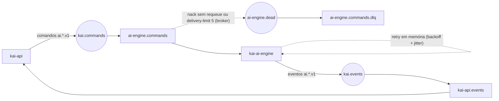

# RabbitMQ: topologia e operação

Decisões: [ADR-0018](../adr/0018-mensageria-rabbitmq-outbox-retry-no-consumidor.md) (outbox, inbox e retry no consumidor; substitui o ADR-0003), [ADR-0016](../adr/0016-clientes-amqp-php-e-python.md) (clientes). Contrato: [`asyncapi/kai-v1.yaml`](../../packages/contracts/asyncapi/kai-v1.yaml). Entrou no M03 E2.1, com as correcções da revisão de segurança aplicadas antes do primeiro commit.

## Arrancar em dev

O RabbitMQ **recusa arrancar** sem passwords fortes. Não há valores por omissão: uma password vazia, com o valor de exemplo (`changeme…`), com menos de 24 caracteres ou com caracteres fora de `[A-Za-z0-9._-]` é recusada. Para as gerar:

```bash
scripts/dev/passwords.sh   # imprime 3 linhas KAI_RABBITMQ_*_PASSWORD=…
```

**Só o owner corre o script**, com o output redireccionado para o ficheiro de ambiente da raiz do repositório (o mesmo que o Docker Compose lê), e nunca através de um agente: as passwords entrariam no transcript. O script não escreve em ficheiro nenhum. Depois: `docker compose --profile messaging up -d rabbitmq`.

O RabbitMQ está no *profile* `messaging`: um `docker compose up` sem profile não o arranca, para um clone limpo continuar a cumprir a AC-01 sem passwords. Deixa de ser opcional quando houver consumidores (E3.4/E4.4).

**Volume de dev antigo:** o nó passou a chamar-se `rabbit@localhost`. Um volume criado antes desta mudança fica com dados órfãos; recria-o (`docker volume rm kai_rabbitmq_data`). O nome do nó fica fixo daqui em diante, porque mudá-lo perde as filas quorum.

**Disco:** com menos de 2 GB livres (`disk_free_limit`), o broker bloqueia os publishers. Num WSL com pouco espaço, o sintoma é publicar sem resposta; confirma com `docker compose exec rabbitmq rabbitmq-diagnostics alarms`.

## Configuração (`infra/rabbitmq/`)

| Ficheiro | O quê |
|---|---|
| `definitions.template.json` | Vhost, utilizadores e limites, permissões, topic permissions, exchanges, filas e bindings. As passwords são marcadores `<NOME>` |
| `render-definitions.sh` | Entrypoint: valida as passwords, substitui os marcadores (com `awk` e `ENVIRON`, nunca no argv), grava em `/tmp` com modo 600, retira as passwords do ambiente e arranca o servidor |
| `rabbitmq.conf` | Carrega as definições; `max_message_size` de 16 MiB (SPEC-003 §6); `disk_free_limit` de 2 GB; gestão e distribuição Erlang só em loopback; logs só na consola |
| `enabled_plugins` | Só a gestão. O Prometheus (15692, sem autenticação) fica desligado até à E7.2 |

- **Imagem:** `rabbitmq:4.4-management` (4.4.1), fixada por digest no `docker-compose.yml`. O nó chama-se `rabbit@localhost`, e o `epmd` (`ERL_EPMD_ADDRESS`) e a distribuição Erlang escutam só em loopback.
- **Rede:** o RabbitMQ está só na rede `messaging` (api, ai-engine, reverb). A partir de outro contentor, **só o AMQP (5672) é alcançável**; a gestão, as métricas, a distribuição Erlang e o `epmd` não o são (testado). Não há portas publicadas no host.
- **Topologia fixa:** nenhum serviço declara exchanges nem filas, nem cria bindings (`configure` vazio). A topologia muda só aqui, por revisão.

## Topologia (vhost `/kai`)



A ponta de eventos é simétrica (`kai-api.events`, `kai-api.dead`, `kai-api.events.dlq`). Não há filas de retry (ADR-0018). Todas as filas são quorum, duradouras e limitadas (10 000 mensagens, 256 MiB, `reject-publish`). O dead-lettering é *at-least-once*. A routing key é o tipo da mensagem.

## Permissões (um utilizador por serviço)

| Utilizador | Escreve em | Tipos permitidos (topic permissions) | Lê de |
|---|---|---|---|
| `kai-api` | `kai.commands` | `ai.conversation.turn.requested.v1`, `ai.mission.step.resume.v1`, `ai.mission.cancel.requested.v1` | `kai-api.events` |
| `kai-ai-engine` | `kai.events` | `ai.conversation.turn.completed.v1`, `ai.conversation.turn.failed.v1`, `ai.mission.step.reported.v1`, `ai.model.usage.recorded.v1` | `ai-engine.commands` |
| `kai-admin` | tudo (operação: DLQ, purge) | — | tudo |

- **Autenticidade da origem:** cada serviço publica com a propriedade AMQP `user_id` igual ao seu utilizador, e o broker recusa um valor falsificado (406). **O consumidor rejeita mensagens sem o `user_id` esperado**: os comandos exigem `kai-api` e os eventos exigem `kai-ai-engine` (E3.4 e E4.5).
- **Limites:** 20 ligações e 100 canais por utilizador; no vhost, 100 ligações e 20 filas.
- **O que fica de fora:** nenhum serviço escreve nem lê a DLQ (só o broker a alimenta, por DLX); o `guest` não existe.

## Retry, backoff e jitter (ADR-0018)

O retry é feito **no consumidor**, sem filas de retry. O retry pelo broker, que foi a primeira versão, perdia mensagens (ver o contexto do ADR-0018):

1. **Falha transitória:** o consumidor repete em memória, com backoff exponencial e jitter (por omissão 3 tentativas, com um tecto de cerca de 30 s), sem fazer `ack`.
2. **Falha que persiste ou permanente** (schema inválido, `user_id` ou dono divergente): `nack` sem requeue → DLX → DLQ, com o `x-death` `rejected` e o `user_id` original.
3. **Crash antes do `ack`:** ao fim de 5 entregas (`x-delivery-limit`), o broker manda a mensagem para a DLQ, com o `x-death` `delivery_limit`. Nunca se perde (testado).

**No AI Engine (E3.4a):** a validação falhada (schema, `user_id`, tipo, routing key, ferramentas) vai logo para a DLQ; a publicação sem confirm repete 3 vezes antes da DLQ; com o Redis da inbox em baixo (nada gasto), volta à fila até ao `x-delivery-limit`; um `ack` só sai depois dos confirms dos eventos. O consumidor obtém a fila e o exchange sem os declarar (o `kai-ai-engine` não tem `configure`) e gere a reconexão ele próprio (ver o [README do ai-engine](../../apps/ai-engine/README.md)).

**Reprocessar uma DLQ** nunca é mover mensagens para a fila principal: o produtor reemite a partir do outbox ou da auditoria, como mensagem nova. O consumidor continua a exigir o `user_id` do produtor; não se abre nenhuma excepção para mensagens "reprocessadas".

## Alterar a topologia

O import de definições no arranque é **aditivo**: remover um utilizador, uma permissão ou uma fila do template não os apaga num volume que já exista. Para revogar, usa `docker compose exec rabbitmq rabbitmqctl clear_permissions -p /kai <utilizador>` (ou `delete_user`, `delete_queue`), ou recria o volume em dev (`docker compose down` e `docker volume rm kai_rabbitmq_data`). A CI parte sempre de um volume novo.

## Operação

A gestão só escuta dentro do contentor. Usa:
- `docker compose exec rabbitmq rabbitmqctl list_queues -p /kai name messages`;
- `rabbitmq-diagnostics`, também dentro do contentor.

## Testes

`scripts/ci/integration.sh` usa uma stack descartável `kai-it`, com passwords aleatórias. Verifica:
- a recusa de arranque com passwords vazias, de exemplo, curtas ou com caracteres inválidos;
- os limites e as topic permissions carregados;
- 32 testes Pest em `apps/api/tests/Integration`:
  - publicação com confirm e `user_id`, e consumo de um exemplo válido do contrato;
  - `user_id` falsificado (406);
  - publicação fora das permissões, incluindo a DLQ própria, a exchange por omissão e as `amq.*` (403);
  - tipos fora das topic permissions (403);
  - leituras e `configure` (403);
  - guest e password errada;
  - só a 5672 alcançável;
  - `nack` → DLQ (`rejected`) e 6 entregas sem `ack` → DLQ (`delivery_limit`);
  - mensagem acima de 16 MiB (406).

## Produção (M10)
- Passwords aleatórias por ambiente, de preferência em ficheiros de secret; rotação.
- TLS no AMQP, se a rede deixar de ser só interna.
- Métricas Prometheus só para o colector (E7.2).
- Alerta para a DLQ não vazia (E7.2).
