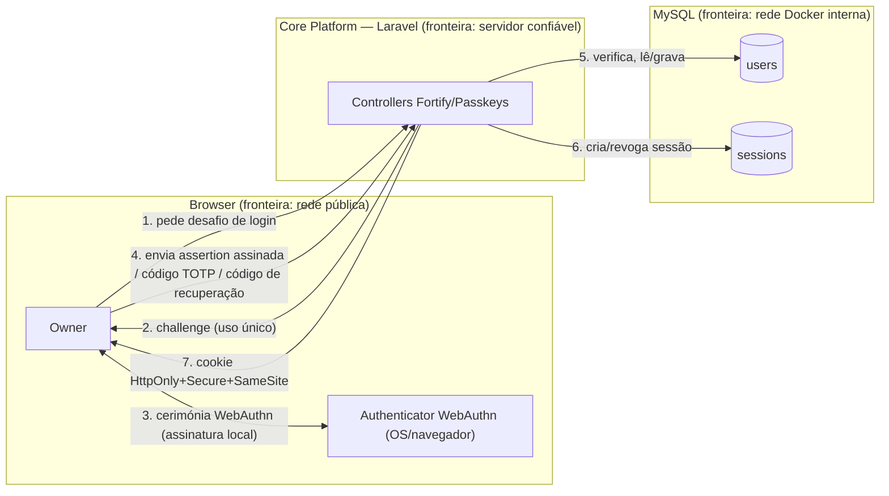

# Modelo de ameaças: Identity & Access (login por passkey/TOTP, sessões)

- **Data:** 2026-11-20
- **Âmbito:** registo e autenticação por passkey (WebAuthn), autenticação por TOTP, uso de código de recuperação, listagem e revogação de sessões. Owner único, conta criada por CLI (D-05), sem registo público.
- **Fora de âmbito:** RBAC completo; qualquer fluxo que envolva o AI Engine, o LLM, o Tool Registry ou conteúdo externo — este módulo é puramente Core Platform ↔ browser, sem Python nem RabbitMQ envolvidos.
- **Relacionados:** SPEC-002 (`docs/specs/002-identity-access.md`), ADR-0004→ADR-0013 (o LLM não é fronteira; aqui nem há LLM), D-05, FR-044, FR-045, FR-051, NFR-008, NFR-009

## Fluxo de dados e fronteiras de confiança

Não há fronteira Laravel↔RabbitMQ↔Python nem Python↔LLM neste módulo — a autenticação não chama o AI Engine.

## Activos

| Activo | Sensibilidade | Onde vive |
|---|---|---|
| Chave privada da passkey | Crítica | Nunca sai do *authenticator* do owner; o servidor só guarda a chave pública |
| Segredo TOTP (seed) | Crítica | `users` (cifrado em repouso pelo Fortify) |
| Códigos de recuperação | Alta | `users` (cifrados, uso único) |
| Sessão do owner (cookie/ID) | Alta | `sessions`, cookie no browser |
| Registo de auditoria de tentativas de login | Média | Logs estruturados (JSON); `audit_logs` dedicada fica para o M05 |

## Ameaças

| ID | Categoria (STRIDE) | Ameaça | P | I | Mitigação | Onde é aplicada | Verificação |
|---|---|---|---|---|---|---|---|
| T-01 | Spoofing | Enumeração de utilizadores via resposta diferente ao pedido de desafio | B | B | Resposta genérica, independente de o username existir | Controller de desafio (Fortify) | Teste: desafio para username existente vs inexistente dá respostas indistinguíveis |
| T-02 | Spoofing / Tampering | Assertion WebAuthn forjada | B | A | Verificação criptográfica da assinatura contra a chave pública registada (`web-auth/webauthn-lib`) | `laravel/passkeys` | Biblioteca padrão; teste de assertion com assinatura inválida é rejeitada |
| T-03 | Tampering / Repudiation | *Replay* de uma assertion WebAuthn capturada | B | A | Challenge de uso único + verificação e incremento do `signCount` do autenticador; rejeitar se não aumentar | `laravel/passkeys` | Teste: reenviar a mesma assertion falha |
| T-04 | Tampering / DoS | Força bruta sobre o código TOTP (10⁶ combinações) | M | A | *Rate limiting*/*throttle* explícito no endpoint de login | Middleware de throttle do Fortify, configurado explicitamente (não assumir omissão) | Teste: N+1 tentativas falhadas bloqueiam temporariamente |
| T-05 | Tampering | Reutilização de um código de recuperação | B | M | Código marcado como consumido na mesma transacção que cria a sessão | Acção de login por código de recuperação | AC-02g (já na spec); teste: usar o mesmo código duas vezes falha na 2.ª |
| T-06 | Information Disclosure | Fuga do segredo TOTP ou dos códigos de recuperação em claro, se a BD for comprometida | B | A | Confirmar que o Fortify cifra estes campos com a `APP_KEY` antes de gravar (NFR-008) | `users` | Teste: inspeccionar a coluna na BD e confirmar que não está em texto claro |
| T-07 | Spoofing / Elevation of Privilege | *Session fixation*/*hijacking* | B | A | Regenerar o ID de sessão no login; cookies `HttpOnly`+`Secure`+`SameSite=Lax` | Controller de login | Teste de configuração dos cookies + teste de regeneração do ID |
| T-08 | Elevation of Privilege / Information Disclosure | IDOR: manipular o ID da sessão para ver/revogar a sessão de outro `user_id` | B | A | Toda a query de sessão filtra por `user_id` da sessão autenticada, nunca confia no ID isolado | Controllers de listagem/revogação de sessão | AC-02f (já na spec, é o teste negativo central) |
| T-09 | Tampering | CSRF num pedido de revogação de sessão | B | M | Token CSRF do Laravel em pedidos que mudam estado; `SameSite=Lax` | Middleware `VerifyCsrfToken` | Teste: pedido de revogação sem token CSRF válido é rejeitado |
| T-10 | Repudiation | Tentativa de login (sucesso ou falha) sem registo rastreável | B | M | Cada tentativa grava em `audit_logs`: actor, método, resultado, `trace_id` (NFR-002) | Controllers de autenticação | Teste: verificar a entrada de auditoria após uma tentativa |
| T-11 | Denial of Service | Inundação do endpoint de login | B | M | *Rate limiting* (mesmo mecanismo de T-04); DoS de rede fica fora deste âmbito (M10) | Middleware de throttle | Coberto por T-04; sem teste adicional aqui |
| T-12 | Elevation of Privilege / Repudiation | Persistência através de uma credencial nova: com um cookie de sessão roubado, o atacante regista a sua própria passkey ou lê/troca o segredo TOTP e os códigos de recuperação; revogar a sessão já não o expulsa (achado da revisão de segurança da E4.6b, 2026-11-21) | M | A | Step-up: as rotas de gestão de credenciais exigem `password.confirm`; sem password, o login (passkey/TOTP/recuperação) e `/passkeys/confirm` marcam a sessão como confirmada; janela `auth.password_timeout` = 600 s (D-05). Cada alteração de credencial fica auditada (`auth.credential.*`, origem cli/http). `kai:enable-totp --force` revoga todas as sessões; `--revoke-passkeys` remove as passkeys (as duas revogações auditadas). Um re-login por cookie de "remember me" nunca conta como confirmação | `config/fortify.php` (`confirmPassword`), `config/auth.php`, `LogAuthenticationAttempt`, `LogCredentialChange`, `EnableTotpCommand` | `RecentAuthenticationTest` (10 rotas → 423 depois de 10 min; "remember me"), `CredentialAuditTest`, `EnableTotpCommandTest` (rotação) |

### Checklist LLM / agentes (obrigatória — todos não aplicáveis aqui)

| ID | Ameaça | Aplicável? |
|---|---|---|
| LLM01 | Prompt Injection | **Não aplicável.** Não há LLM nem conteúdo externo neste fluxo. |
| LLM02 | Sensitive Information Disclosure | Parcialmente coberto por T-06 (segredos em repouso) e pela regra de logs da SPEC-002 (nunca logar TOTP, assertion ou código de recuperação). |
| LLM03 | Supply Chain | Aplicável: `laravel/fortify`/`laravel/passkeys` são dependências novas, já com licença (MIT) e versão verificadas e aprovadas pelo owner na E4.1, fixadas em `composer.lock`. |
| LLM04 | Data and Model Poisoning | **Não aplicável.** Não há memória de longo prazo nem índice neste módulo. |
| LLM05 | Improper Output Handling | **Não aplicável.** Não há output de LLM a renderizar. |
| LLM06 | Excessive Agency | **Não aplicável.** Não há ferramentas nem agentes neste fluxo — é autenticação do Core Platform, não execução via Tool Registry (ADR-0013). |
| LLM07 | System Prompt Leakage | **Não aplicável.** Não há *system prompt*. |
| LLM08 | Vector and Embedding Weaknesses | **Não aplicável** a pesquisa vectorial; o isolamento por `user_id` equivalente está coberto por T-08 (NFR-009). |
| LLM09 | Misinformation | **Não aplicável.** Não há geração de texto por LLM. |
| LLM10 | Unbounded Consumption | **Não aplicável** a tokens/custo de LLM; o equivalente (tentativas de login) está coberto por T-04. |
| SSRF | Fetch para a rede interna | **Não aplicável.** Não há *fetch* para URLs externas neste fluxo. |
| EXFIL | Exfiltração por ferramentas | **Não aplicável.** Não há leitura de dados privados seguida de escrita externa neste fluxo. |

## Riscos residuais

| ID | Risco | Decisão necessária (P-xxx) |
|---|---|---|
| R-01 | DoS de rede/infraestrutura sobre o endpoint de login | Nenhuma — tratado como parte da observabilidade/resiliência geral no M10, não específico deste módulo |
| R-02 | O owner perde a passkey, o TOTP e todos os códigos de recuperação ao mesmo tempo: não há via de recuperação de conta | Nenhuma — aceite para a v1 pessoal (D-05 já assume que o owner é responsável pela própria recuperação); revisitar só se o produto evoluir para multi-utilizador |

## Testes a criar

Feitos na E4.5 (`tests/Feature/Auth/TotpLoginTest.php`, `SessionManagementTest.php`; 23 testes, SQLite isolado e confirmação manual contra MySQL real):

- [x] T-01: resposta idêntica (estado + corpo) para email inexistente vs código errado
- [x] T-02/T-03 (E4.6b, E2E): uma assertion com a assinatura adulterada em trânsito é rejeitada; reenviar uma assertion válida já usada (mesmo com um challenge novo na sessão) é rejeitado. Virtual Authenticator do CDP, `apps/web/e2e/ac-02-identity-access.spec.ts`
- [x] T-04: 6.ª tentativa de TOTP seguida bloqueia (429)
- [x] T-05: reutilizar um código de recuperação falha na 2.ª tentativa (AC-02g)
- [x] T-06: segredo TOTP e códigos de recuperação não estão em texto claro na BD
- [x] T-07 (E4.6b, E2E): o cookie de sessão é `HttpOnly` e `SameSite=Lax`; o cookie anónimo de antes do login não fica autenticado (sem *session fixation*). **`Secure` não é verificável em `http://localhost`**: vem de `SESSION_SECURE_COOKIE` com HTTPS, a garantir no M10 (produção)
- [x] T-08: listar/revogar a sessão de outro `user_id` falha (AC-02f)
- [x] T-09: confirmado manualmente contra a stack real (não em teste automático — o Laravel desactiva CSRF em testes, por desenho): um token CSRF desactualizado dá 419
- [x] T-10: login com sucesso e falha de TOTP geram cada um uma entrada de log estruturado; desde a E4.6b, o sucesso regista o `method` (`passkey`/`totp`/`recovery_code`), verificado em `CredentialAuditTest` e no log real pelo `scripts/e2e.sh`
- [x] T-12 (E4.6b): step-up para gerir credenciais, auditoria de alterações de credenciais e rotação que revoga sessões — `RecentAuthenticationTest`, `CredentialAuditTest`, `EnableTotpCommandTest`
